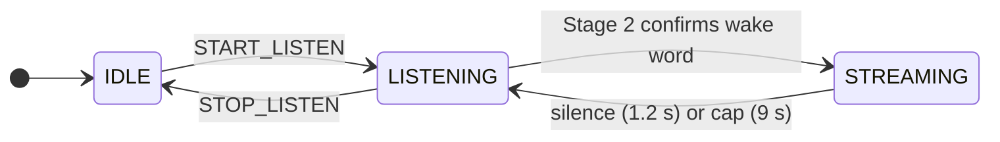
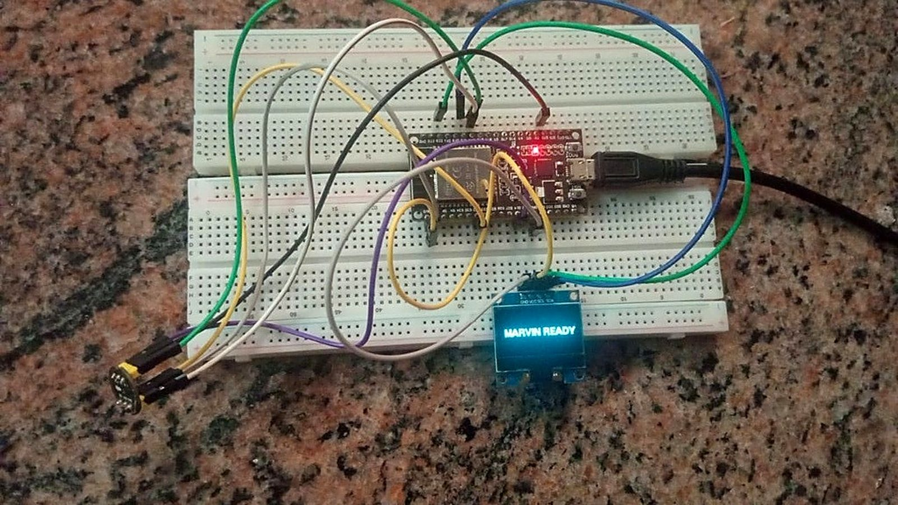
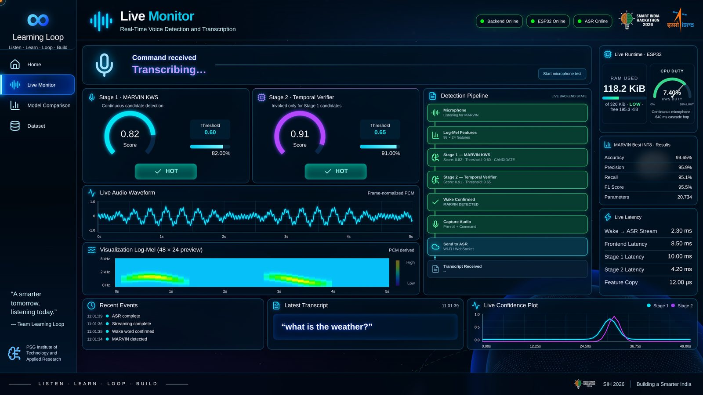
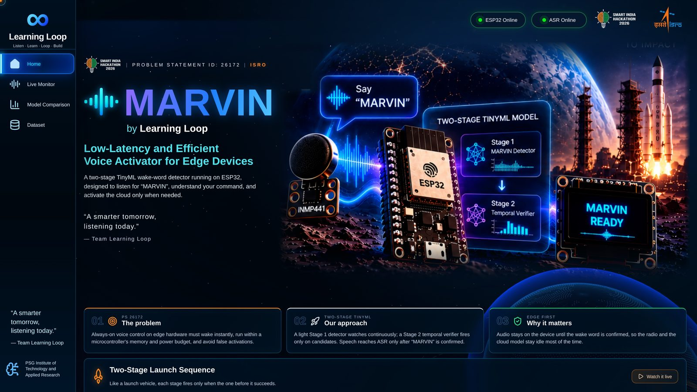
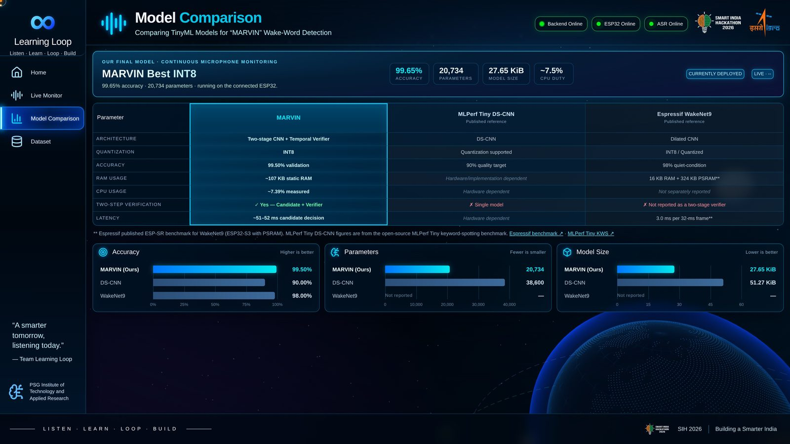
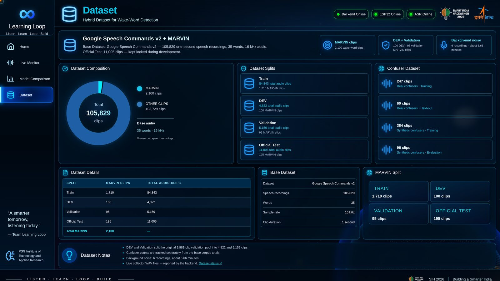

<div align="center">


**On-device wake-word detection for the ESP32, verified twice before any audio leaves the chip.**

Smart India Hackathon 2026 &nbsp;·&nbsp; Problem Statement SIH26172 &nbsp;·&nbsp; Team The Learning Loop

[](#hardware)
[](#how-it-works)
[](backend/)
[](frontend/)

[Interactive walkthrough](https://dharshan188.github.io/SIH26172--The-Learning-Loop/) &nbsp;|&nbsp;
[How it works](#how-it-works) &nbsp;|&nbsp;
[Hardware](#hardware) &nbsp;|&nbsp;
[Getting started](#getting-started) &nbsp;|&nbsp;
[Project write-up](SIH_IDEA_DESCRIPTION.md)

</div>

<br/>

## Overview

Most voice assistants decide whether they were addressed by streaming or buffering ambient audio. That costs privacy, battery and latency, and it fails without a network.

MARVIN makes the decision on a stock ESP32. A 17 KB INT8 network screens audio every 500 ms. An independent second network then verifies each candidate. Only after both agree does the device open a WebSocket and stream the utterance to a self-hosted speech recogniser. Before that point, no audio is stored or transmitted.

<br/>

<div align="center">

</div>

| Accuracy | Precision | Recall | F1 | Latency | CPU | RAM | Model size |
|:-:|:-:|:-:|:-:|:-:|:-:|:-:|:-:|
| **99.5 %** | **95.9 %** | **95.1 %** | **95.5 %** | **~50 ms** | **7.4 %** | **~114 KB** | **17,256 B** |

<sub>Measured on an ESP32-WROOM-32 at 240 MHz with no PSRAM and no accelerator. The model has ~20.7 K INT8 parameters.</sub>

<br/>

## How it works

<div align="center">

</div>

| Stage | Detail | Runs on |
|---|---|---|
| **Capture** | INMP441 I²S microphone, 16 kHz mono PCM into a rolling buffer | ESP32 |
| **Feature extraction** | Window, radix-2 FFT, mel filterbank and log, giving a 98 × 24 log-mel spectrogram. Verified against the TensorFlow reference by [`tools/check_frontend.py`](tools/check_frontend.py) | ESP32 |
| **Stage 1 (sentinel)** | INT8 CNN evaluated every 500 ms and tuned for recall. A candidate must persist across a three-window gate | ESP32 |
| **Stage 2 (verifier)** | Independent INT8 model, invoked only for gated candidates and tuned to reject near-miss words | ESP32 |
| **Streaming** | 20 ms PCM16 frames over a binary WebSocket. Stops after 1.2 s of silence or a 9 s cap | Wi-Fi |
| **Transcription** | `faster-whisper` (CTranslate2, INT8), self-hosted with no third-party API | Laptop or gateway |
| **Output** | Transcript on the OLED and the live dashboard | OLED, browser |

### Device states



In `IDLE` and pre-wake `LISTENING`, audio is only analysed on-chip. It is never captured for ASR or sent over the network.

### Why a cascade

A single small classifier has to trade missed detections against false wakes. MARVIN splits that trade-off across two models. The first is cheap and permissive. The second is strict, and it runs only on the rare frames that reach it, so it adds almost no average load.

<div align="center">

</div>

<br/>

## Hardware

<table>
<tr>
<td width="58%"></td>
<td width="42%">

| Component | Role |
|---|---|
| ESP32-WROOM-32 DevKit V1 | Feature extraction and both models |
| INMP441 | I²S MEMS microphone |
| SH1106 128×64 OLED | Device state and transcript |

| Signal | GPIO |
|---|:-:|
| Mic SCK / BCLK | 14 |
| Mic WS / LRCLK | 15 |
| Mic SD | 32 |
| OLED SDA | 21 |
| OLED SCL | 22 |

Mic L/R is tied to GND. All modules run from 3V3.

</td>
</tr>
</table>

<div align="center">

</div>

<br/>

## Dashboard

A React and Three.js dashboard shows each decision as it happens: Stage 1 and Stage 2 scores against their thresholds, the waveform and log-mel input, the detection pipeline, ESP32 heap/CPU/latency, and the transcript. Offline benchmark results are kept separate from live device telemetry.



<table>
<tr>
<td width="33%"></td>
<td width="33%"></td>
<td width="33%"></td>
</tr>
<tr>
<td align="center"><sub>Overview</sub></td>
<td align="center"><sub>Comparison with TinyML baselines</sub></td>
<td align="center"><sub>Dataset curation</sub></td>
</tr>
</table>

<br/>

## Getting started

**Requirements:** an ESP32 DevKit wired as above, PlatformIO (or Arduino IDE with ESP32 core 3.2.0), Python 3.10+ and Node 18+.

**1. Flash the firmware**

```bash
cp src/wifi_config.h.example src/wifi_config.h    # set SSID and password
pio run -t upload --upload-port /dev/ttyUSB0
```

The device boots in `IDLE` and accepts `START_LISTEN`, `STOP_LISTEN` and `SERVER <host> <port>` over serial at 115200 baud. For an Arduino IDE build, see [`arduino/README.md`](arduino/README.md).

**2. Start the backend**

```bash
cd backend
python -m venv .venv && source .venv/bin/activate
pip install -r requirements.txt
MARVIN_SERIAL_PORT=/dev/ttyUSB0 MARVIN_SERVER_PORT=8011 \
  uvicorn app:app --host 0.0.0.0 --port 8011
```

The first run downloads `Systran/faster-whisper-small.en`. Set `MARVIN_ASR_MODEL=Systran/faster-whisper-base.en` for a lighter model, or `MARVIN_DISABLE_ASR=1` to run detection only.

**3. Start the dashboard**

```bash
cd frontend
npm install
VITE_BACKEND_URL=http://127.0.0.1:8011 npm run dev
```

Open `http://localhost:5173` and select **Start listening**. Only one process can hold the serial port, so close any other serial monitors first.

<br/>

## Repository structure

```text
arduino/MarvinWakeWord/   Firmware: I²S capture, log-mel frontend, TFLM cascade, OLED, Wi-Fi
src/                      PlatformIO entry points
models/                   Stage 1 and Stage 2 models (INT8 .tflite, FP32 .keras) and config
backend/                  FastAPI service: serial control, WebSocket audio, ASR, dataset store
frontend/                 React dashboard
tools/                    Frontend parity check, model inspection, serial monitoring
hardware_runs/            Serial logs from on-device runs
docs/                     README graphics and the interactive walkthrough
```

<br/>

## Roadmap

- Wake words in Indian languages, with a Stage 2 verifier per language
- An on-device command set (lights, call, SOS) that needs no network
- Few-shot custom wake words and speaker-aware verification
- A custom low-power PCB with light-sleep duty cycling and OTA model updates

<br/>

## Team

**The Learning Loop** (Team ID 158994), PSG Institute of Technology and Applied Research.
Built for Smart India Hackathon 2026, problem statement SIH26172.

The full proposal, covering impact, risk analysis and comparison with existing approaches, is in [SIH_IDEA_DESCRIPTION.md](SIH_IDEA_DESCRIPTION.md).
